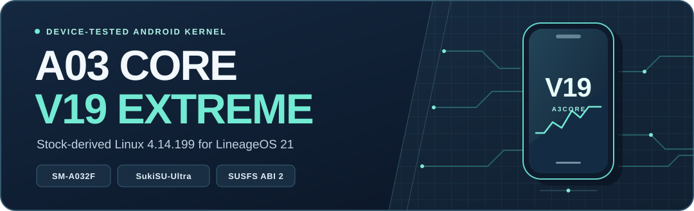
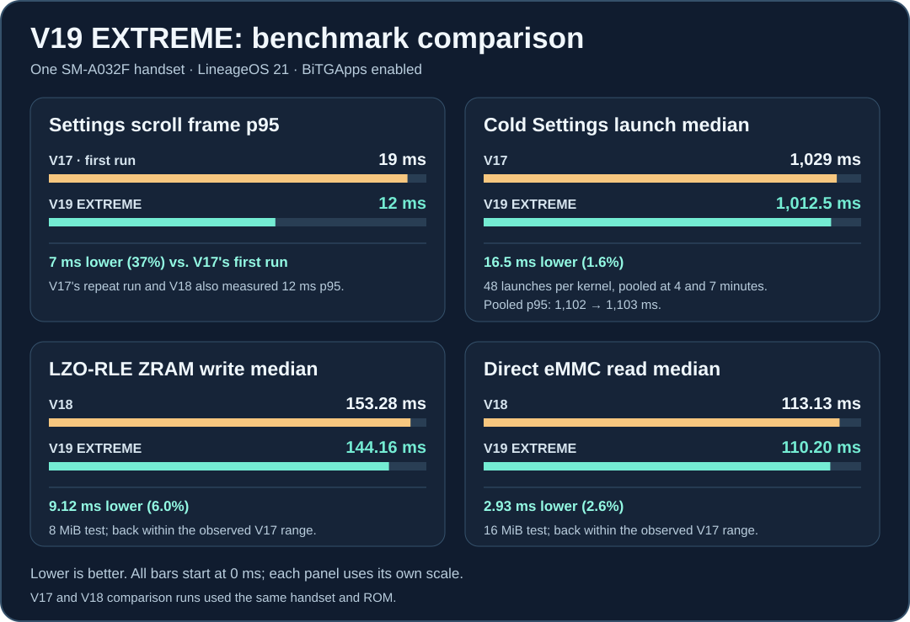

# A03 Core V19 EXTREME

**The most thoroughly validated Galaxy A03 Core kernel in this project.** V19 combines targeted latency work with the original vendor GPU ABI, a **Samsung Galaxy A03 Core SM-A032F**.

[**Download V19 EXTREME**](https://github.com/Artemis1447/A032F-V19-EXTREME/releases/tag/a3core-v19-extreme-20261127) · [**Benchmarks and validation**](docs/v19-validation.md) · [**Build, install and roll back**](V19.md) · [**V17 recovery baseline**](https://github.com/Artemis1447/A032F-V19-EXTREME/releases/tag/a3core-v17-sukisu-susfs-20261124)

## The headline numbers

| Measured improvement | Before → V19 | Difference |
|---|---:|---:|
| Settings scroll frame p95 vs. V17's first run | **19 → 12 ms** | **7 ms lower (37%)** |
| Cold Settings launch median vs. V17, pooled 4- and 7-minute windows | **1,029 → 1,012.5 ms** | **16.5 ms lower (1.6%)** |
| 8 MiB LZO-RLE write median vs. V18 | **153.28 → 144.16 ms** | **9.12 ms lower (6.0%)** |
| 16 MiB direct eMMC read median vs. V18 | **113.13 → 110.20 ms** | **2.93 ms lower (2.6%)** |

V17's repeat scroll test and V18 both already measured **12 ms p95**. The pooled cold-launch median uses 48 launches per kernel; its p95 was essentially unchanged (**1,102 → 1,103 ms**).

| Metric on the reference SM-A032F | V19 EXTREME |
|---|---:|
| Settled Settings cold launch at 15 minutes | **993 ms median / 1,024 ms p95** |
| Fastest measured V19 cold launch | **975 ms** |
| Janky frames in the measured scroll | **0 / 423** |
| Stock PowerVR symbol-version checks | **267 / 267 passed** |

V19 also brought direct eMMC read and LZO-RLE write medians back within the range observed on V17. Results are from one handset; the 15-minute run has no matched V17/V18 comparator, and the historical 743–800 ms target was not reached. [See the full comparison and tradeoffs.](docs/v19-validation.md)

## Test setup: Google apps installed

The benchmarks ran on the **2 GB SM-A032F** with **LineageOS 21 (`21.0-20250125-UNOFFICIAL-a3core`), Android 14, and 32-bit ARM userspace**. The phone had **BiTGApps enabled, including Google Play services and the Google Play Store**, and the same seven SukiSU modules were enabled across V17, V18 and V19.

The headline cold-launch runs used USB power, animation scales set to `0`, and **2.5 GiB LZO-RLE ZRAM** with `vm.swappiness=140`. Google apps and modules describe the test environment; the kernel download does not include them. [Full benchmark configuration](docs/v19-validation.md#test-configuration).

## Built for this hardware

| Component | V19 target |
|---|---|
| Device | **SM-A032F (`a3core`)**, Unisoc SC9863A, Cortex-A55 |
| Tested ROM | LineageOS 21 / Android 14, **32-bit ARM userspace** |
| Kernel | **Linux 4.14.199**, arm64, Samsung stock-derived |
| Graphics | Stock PowerVR Rogue `pvrsrvkm`; byte-identical V17 `Module.symvers` |
| Root and filesystem extension | **SukiSU-Ultra** with **SUSFS v1.5.5, extension ABI 2** |
| Build | Android Clang **11.0.1 (`r383902`)**; pinned source, strict patch application and artifact checksums |

### What makes V19 different

- **Lean graphics allocation:** ION no longer allocates and frees a temporary descriptor for each buffer chunk. It also drops per-buffer diagnostic logging from the allocation path.
- **Less work on the hot paths:** ZRAM publishes successful writes under its existing slot lock. Schedutil skips a redundant retry wakeup when a saturated frequency vote is already satisfied. LZO-RLE remains the active compressor on the tested ROM.
- **Cleaner boot:** The alternate Novatek probe's cleanup was fixed. The V18 `devm_kfree` warning was absent from the captured V19 boot, and the selected touchscreen driver registered.
- **Stock compatibility:** Existing clock limits, thermal protection, and proprietary GPU driver stay in place. On-device checks confirmed SELinux **Enforcing**, working `su`, SUSFS ABI 2, and a live PowerVR driver.

## Download and build

The [V19 release](https://github.com/Artemis1447/A032F-V19-EXTREME/releases/tag/a3core-v19-extreme-20261127) includes the raw `Image`, a device-scoped AnyKernel3 ZIP, integrated kernel source, a build manifest, ABI reports and SHA-256 checksums from [the verified Actions run](https://github.com/Artemis1447/A032F-V19-EXTREME/actions/runs/45915725325). `Image` is the raw kernel for repacking a full Boot image. The hardware test used the repacked full Boot image through TWRP. The AnyKernel3 ZIP was verified offline.

**Root manager for V17/V19:** [Download SukiSU Nova Manager v3.0.0 (ARM32 APK)](https://github.com/Artemis1447/A032F-V19-EXTREME/releases/download/a3core-v19-extreme-20261127/SukiSU_Nova_v3.0.0_35000-armeabi-v7a-release.apk) from the release assets. Install it as a normal Android app. This is the signed `armeabi-v7a` APK from [SukiSU Nova](https://github.com/SukiSU-Nova/SukiSU-Nova/releases/tag/v3.0.0); the tested ROM runs 32-bit apps. The legacy V12 kernel uses [KernelSU v0.9.5](https://github.com/tiann/KernelSU/releases/tag/v0.9.5) instead.

Build from **Actions → Build Kernel → Run workflow → `main`**. The default dispatch profile is [`config/a3core-a032f-v19-extreme.env`](config/a3core-a032f-v19-extreme.env). [Installation and rollback instructions](V19.md) explain how to preserve your own complete V17 Boot backup.

## Project history and documentation

- **V19 EXTREME:** [latest release](https://github.com/Artemis1447/A032F-V19-EXTREME/releases/tag/a3core-v19-extreme-20261127), with the current source and build profile on `main`. [`v19-extreme`](https://github.com/Artemis1447/A032F-V19-EXTREME/tree/v19-extreme) retains the development history.
- **V18:** [stock-derived comparison build and results](V18.md).
- **V17:** [published baseline and known-good rollback reference](https://github.com/Artemis1447/A032F-V19-EXTREME/releases/tag/a3core-v17-sukisu-susfs-20261124).
- **Build system:** [general workflow documentation](README_EN.md), based on [KernelSU Action](https://github.com/xiaoleGun/KernelSU_action). Kernel source: [IverCoder's Samsung A03 Core tree](https://github.com/IverCoder/android_kernel_samsung_a3core).
